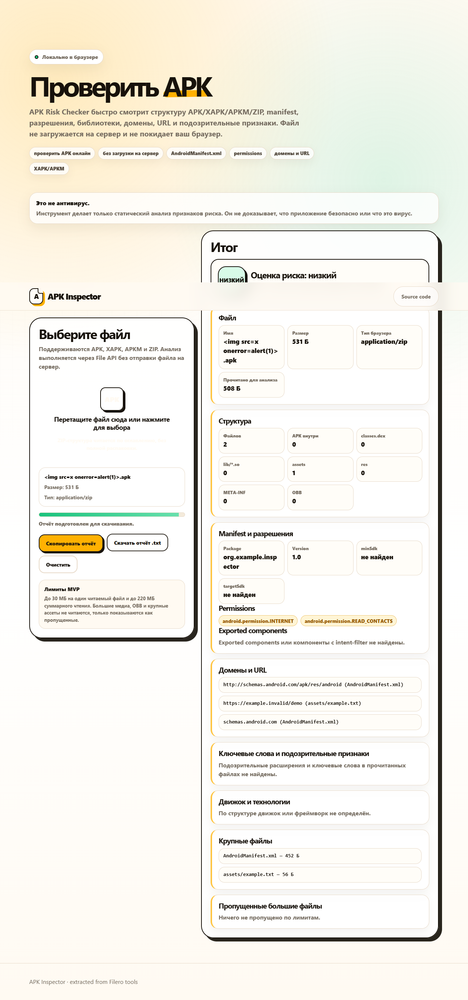

# APK Inspector

Inspect an APK, XAPK, APKM or ZIP locally in your browser without installing the app
or uploading the selected file. Extracted from the Filero development tools.



## Run

```sh
python -m http.server 8080 --bind 127.0.0.1
```

Open http://127.0.0.1:8080 in a current Chrome, Edge or Firefox. Directly opening
`index.html` also works where the browser supports the required File and
DecompressionStream APIs. No backend or third-party scripts are used.

The Russian UI reports ZIP structure, binary/plain AndroidManifest permissions and
components, native libraries/framework hints, embedded URLs/domains, suspicious
strings, skipped data and a downloadable text report.

## Limits

This is static triage, not an antivirus or proof of safety. Scanning is bounded
(30 MB per selected entry, 220 MB total). Large resources are skipped. Encrypted,
obfuscated and dynamically loaded behavior cannot be fully examined; nested split
containers do not imply complete analysis of every nested APK.

`static_apk_triage.py` is a separate Python CLI for DEX/AXML inspection:

```sh
python static_apk_triage.py --help
```

No application packages or private analysis reports are bundled.
`tests/make_fixture.py` generates a metadata-only ZIP (not an installable Android
app). `docs/synthetic-report.txt` shows the resulting analysis. Browser checks
covered malformed ZIP handling, deflate extraction, permissions/domains, filename
escaping, report download and reset.
Русский: локальный анализ APK в браузере — разрешения, компоненты, строки и структура.
